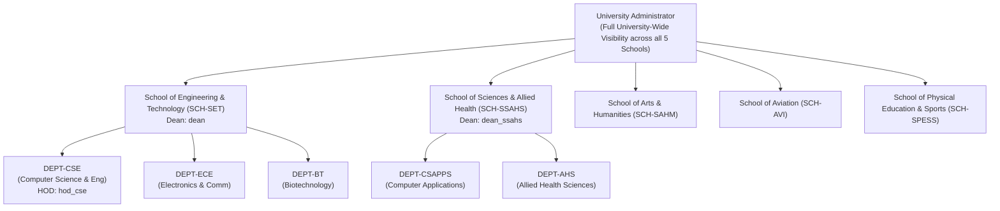
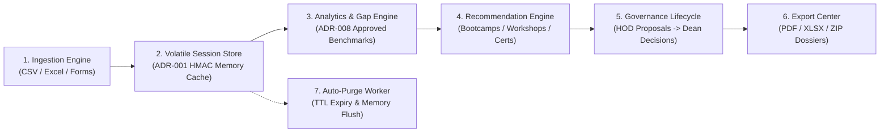
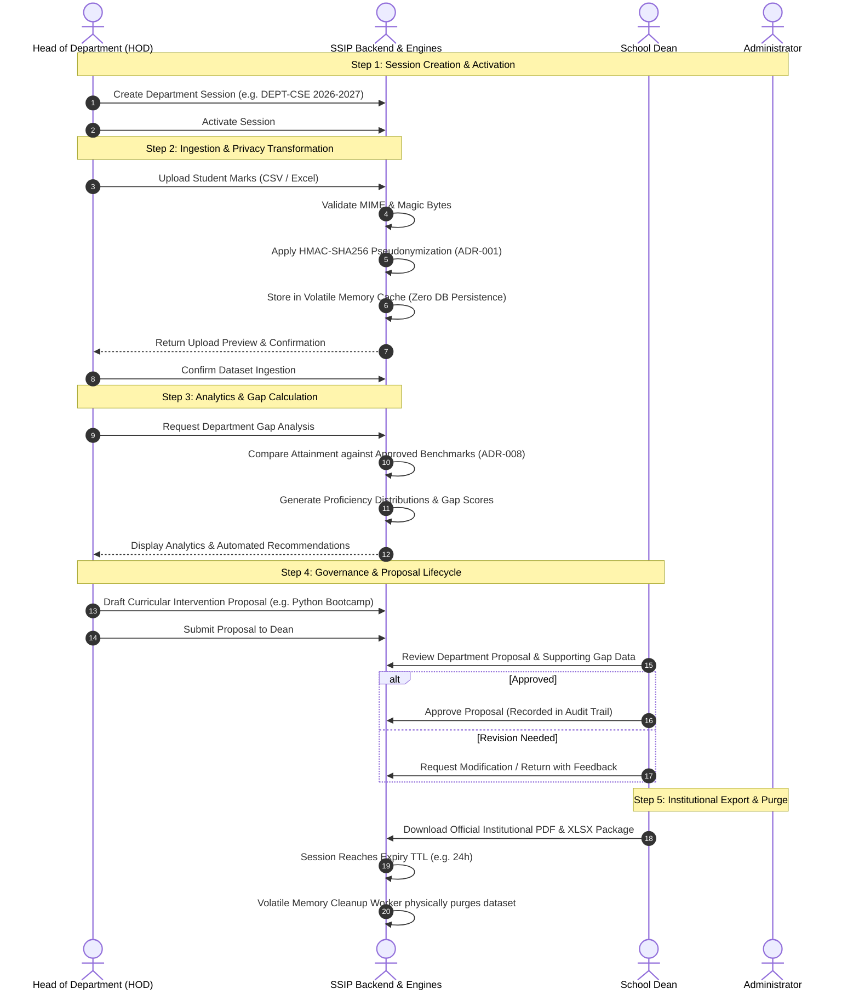
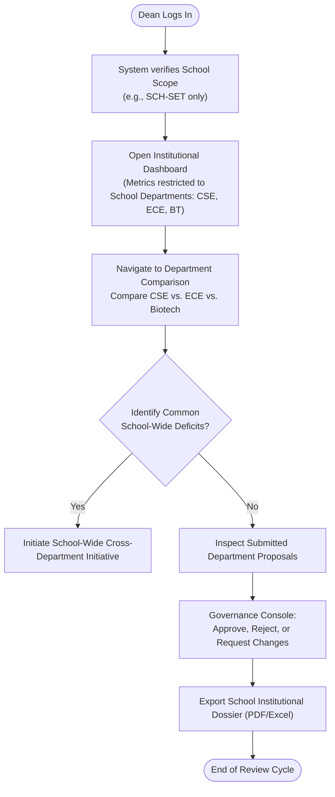
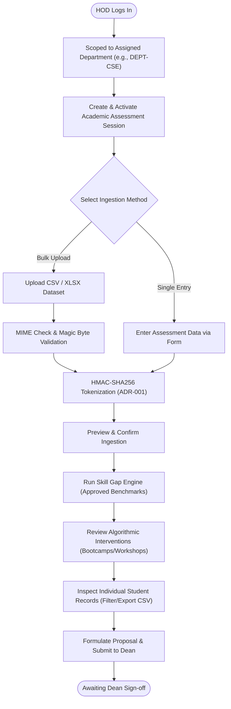
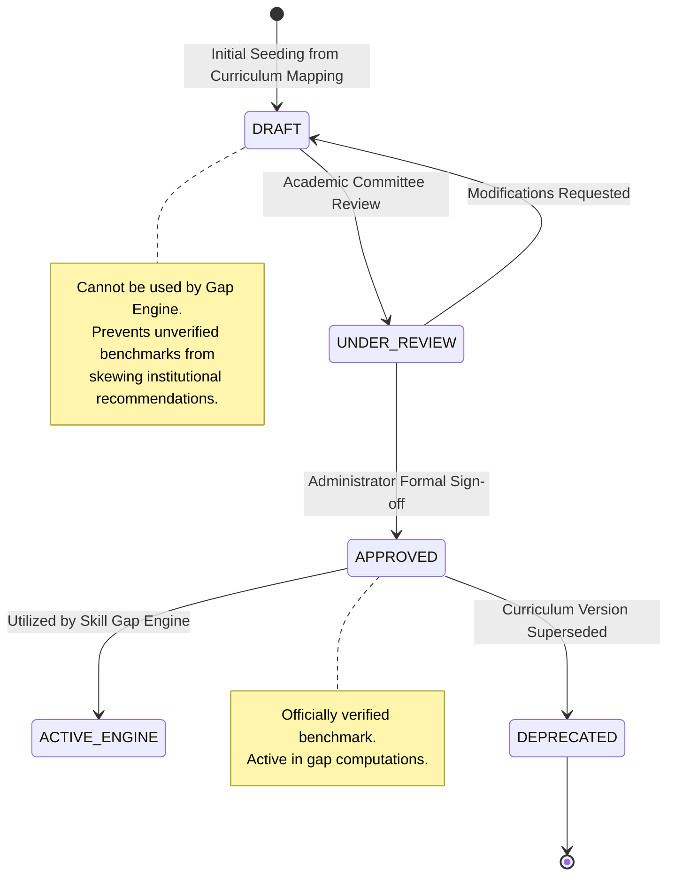
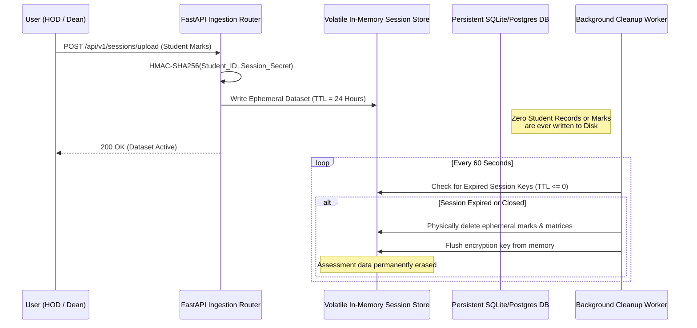

# Student Skill Intelligence Platform (SSIP) — About & Architecture Guide

**Document Version:** 1.0  
**Project:** Student Skill Intelligence Platform (SSIP)  
**Institution:** Jeppiaar University  
**Last Updated:** November 2026  

---

## 1. Executive Summary & Philosophy

The **Student Skill Intelligence Platform (SSIP)** is an institutional-grade, privacy-first decision support system designed for universities to assess, analyze, and bridge student competency gaps across academic departments.

Unlike conventional academic management systems, SSIP is built on an **Architectural Zero-Database Retention Policy** for student assessment submissions:
- **Zero Identifiable Data Persistence:** Raw student marks, registration numbers, and PII are never permanently written to database disks.
- **HMAC Pseudonymization (ADR-001):** Identifiers are cryptographically transformed in volatile memory using a server-held secret key into ephemeral tokens (`STU-<HEX>`).
- **Session-Scoped Lifecycle:** Analysis datasets, proposal drafts, and gap reports are bound to active academic sessions that automatically expire and purge from memory.
- **Hierarchical Institutional Governance:** Clear separation of academic authority among **Deans** (School-level governance), **Heads of Department (HODs)** (Department-level curriculum interventions), and **Administrators** (Platform & Taxonomy configuration).

---

## 2. Institutional Structure & Role Scope (Jeppiaar University)

Jeppiaar University operates across five constituent schools, each headed by **one Dean**. Departments report to their respective school:

### The "One Dean Per School" Rule:
1. **Deans have School-Level Scoping:** A Dean (e.g., `dean` assigned to `SCH-SET`) sees **only** their assigned school and its constituent departments (`DEPT-CSE`, `DEPT-ECE`, `DEPT-BT`). They cannot view other schools or unauthorized departments.
2. **Administrators have Institutional Oversight:** Only the Administrator role has the global multi-school switcher to review university-wide aggregations.
3. **HODs have Departmental Scoping:** An HOD (e.g., `hod_cse`) is restricted strictly to their assigned department (`DEPT-CSE`).

---

## 3. Role-Based Access Control (RBAC) Matrix

| Feature / Module | Administrator | Dean | Head of Department (HOD) | Student / Candidate |
| :--- | :---: | :---: | :---: | :---: |
| **Multi-School University Overview** |  Full Access |  Denied (School only) |  Denied |  Denied |
| **School-Scoped Dashboard & Comparison** |  All Schools |  Assigned School |  Denied |  Denied |
| **Department Dashboard & Gap Analysis** |  View All |  School Depts |  Assigned Dept |  Denied |
| **Create & Activate Assessment Sessions** |  Platform-wide |  School Scope |  Assigned Dept |  Denied |
| **Bulk Dataset Ingestion (CSV / Excel)** |  Permitted |  School Scope |  Assigned Dept |  Denied |
| **Individual Student Assessment Data** |  All (Pseudonyms) |  School Depts |  Assigned Dept |  Own Token Only |
| **Export Individual Records to CSV** |  Permitted |  Permitted |  Permitted |  Denied |
| **Review Automated Recommendations** |  View Rules |  School Initiatives |  Assigned Dept |  Denied |
| **Draft & Submit Curricular Proposals** |  Denied |  Initiate Institutional |  Department Draft |  Denied |
| **Approve / Reject Curricular Proposals** |  Denied |  Authorized |  Denied |  Denied |
| **Benchmark Approval (DRAFT $\rightarrow$ APPROVED)** |  Authorized |  Review & Recommend |  View Only |  Denied |
| **Skill Taxonomy & Category Management** |  Full CRUD |  View Only |  View Only |  Denied |
| **Operational Health & Memory Telemetry** |  Full Access |  Denied |  Denied |  Denied |
| **Institutional Reports Export (PDF/XLSX/ZIP)** |  Permitted |  Permitted |  Department Only |  Denied |

---

## 4. Deep-Dive: Roles, Responsibilities & Features

### 4.1 Role 1: Administrator (`ROLE-001`)
*Technical and operational governance of the platform.*

- **Key Responsibilities:**
  - Maintain operational uptime, server health, and memory telemetry.
  - Manage user accounts, role bindings, and department/school assignments.
  - Maintain the official Skill Taxonomy (Categories, Domains, Relevance Weights).
  - Review and formally approve candidate benchmarks (**ADR-008**: transitioning seeded benchmarks from `DRAFT` to `APPROVED`).
  - Oversee automated session sweep cycles and volatile memory cleanup.
- **Key Features & UI Screens:**
  - **Overall Institutional Dashboard:** View aggregated KPIs across all 5 schools with an interactive School Filter selector.
  - **Skill Taxonomy Management:** Add, edit, and deactivate skill categories and domain definitions.
  - **Department & Academic Management:** Manage institutional hierarchy, school codes, and department mappings.
  - **Benchmark Approval Center:** Inspect baseline targets, evaluate candidate mappings, and mark benchmarks as approved for gap computations.
  - **Operational Monitoring & Audit Logs:** Live monitoring of active memory sessions, RAM consumption, rate-limiting violations, and security headers.

---

### 4.2 Role 2: Dean (`ROLE-002`)
*Institutional academic leadership and cross-departmental oversight for their assigned school.*

- **Key Responsibilities:**
  - Track holistic skill proficiency distributions across all departments within their school.
  - Identify inter-departmental competency gaps and duplicate skill remediation efforts.
  - Evaluate curricular intervention proposals submitted by HODs.
  - Approve, reject, request modifications, or defer departmental proposals.
  - Download official school-level accreditation reports and analysis dossiers.
- **Key Features & UI Screens:**
  - **School-Scoped Institutional Dashboard:** Real-time visual metrics scoped specifically to their school (e.g., School of Engineering & Technology).
  - **Department Comparison Matrix:** Side-by-side comparative analysis of departmental proficiencies (CSE vs. ECE vs. Biotech).
  - **Proposal Decision Console:** Governance review portal to approve or reject remediation plans with recorded justification comments.
  - **School Benchmark Review:** Review benchmark alignments across programs within their school.
  - **Individual Records Viewer:** Audit individual assessment records across their school's departments.
  - **Institutional Export Center:** Generate PDF executive summaries, XLSX audit workbooks, and ZIP packages.

---

### 4.3 Role 3: Head of Department / HOD (`ROLE-003`)
*Departmental curriculum optimization and localized student remediation.*

- **Key Responsibilities:**
  - Create and manage academic assessment sessions for their cohort.
  - Ingest student assessment results (via interactive web forms or bulk Excel/CSV upload).
  - Analyze departmental skill distributions and missing competency deficits against approved benchmarks.
  - Review algorithmic recommendations generated by the Recommendation Engine.
  - Formulate and submit formal curricular proposals (Bootcamps, Elective Overhauls, Industry Workshops) to the Dean.
  - Inspect individual student assessment outcomes for targeted academic advising.
- **Key Features & UI Screens:**
  - **Department Analytics Dashboard:** High-impact visualizations of departmental skill distributions (Beginner, Intermediate, Expert).
  - **Curriculum Gap Analysis Engine:** Automated delta calculation between student achievement and approved benchmarks, highlighting critical deficits.
  - **Actionable Recommendation Feed:** Algorithmic categorization into Bootcamps, Workshops, and Certification Tracks based on urgency.
  - **Governance Proposal Builder:** Draft, edit, and submit remediation initiatives directly to the Dean for funding and approval.
  - **Individual Assessment Records:** Searchable, filterable table showing anonymized student IDs (`STU-<HEX>`), skill names, proficiency levels, and test scores, with a **1-click CSV Export**.
  - **Session Ingestion Hub:** Drag-and-drop file upload with real-time format validation, magic byte checking, and preview before confirmation.

---

### 4.4 Role 4: Student / Candidate (`ROLE-004`)
*Skill assessment participant.*

- **Key Responsibilities:**
  - Complete form-based skill assessments during an active academic session.
  - Submit evidence of proficiency without risking PII leakage.
- **Privacy Guarantees:**
  - Raw identifiers (names, roll numbers) are immediately hashed in volatile memory upon ingestion using a server-held HMAC-SHA256 secret.
  - No persistent student profile is retained across sessions.
  - Assessment records expire automatically at the conclusion of the session TTL.

---

## 5. Core Platform Functionalities & Architectural Modules

### 5.1 Ingestion & Validation Engine
- **File Parser:** Supports CSV and XLSX parsing up to 25 MB with MIME type verification and magic byte validation (rejecting disguised executables or malicious files).
- **Duplicate Handling (ADR-006):** Employs explicit resolution strategies (`OVERWRITE_WITH_LATEST`, `AVERAGE_SCORES`, or `REJECT_DUPLICATES`).
- **Formula Injection Defense (ADR-005):** Neutralizes spreadsheet injection attacks (`=`, `+`, `-`, `@`) during parsing and export.

### 5.2 Analytics & Curriculum Gap Engine
- **Proficiency Aggregation:** Normalizes raw assessment scores into standardized tiers:
  - **Beginner (Foundation):** $0\% - 49\%$
  - **Intermediate (Practical Application):** $50\% - 74\%$
  - **Expert (Advanced Mastery):** $75\% - 100\%$
- **Benchmark Gap Computation:** Calculates the deficit between student cohort attainment and approved academic targets:
  $$\text{Gap Score} = \max(0, \text{Target Proficiency} - \text{Attained Proficiency})$$
- **Draft vs. Approved Protection (ADR-008):** Unapproved or draft benchmarks are strictly excluded from institutional gap calculations until authorized by an Administrator.

### 5.3 Algorithmic Recommendation Engine
Automatically evaluates gaps and synthesizes targeted interventions:
- **Critical Core Deficits:** Triggers **Intensive Bootcamps** for mandatory foundational skills with low cohort coverage.
- **Practical Application Gaps:** Triggers **Hands-on Workshops & Lab Modules** for intermediate-level deficits.
- **Advanced Competencies:** Generates **Industry Certification Tracks** to elevate top-quartile students.

### 5.4 Individual Assessment Records Explorer
- **Real-Time Data Table:** Ephemerally queries active session data to display individual student records.
- **Data Attributes:** Pseudonym (`STU-<HEX>`), Department, Skill Name, Numerical Score, Proficiency Level, Timestamp.
- **Interactive Controls:** Real-time search, department filter, proficiency level filter, and instant **Export to CSV**.

### 5.5 Institutional Export Center
- **Executive PDF Dossier:** Print-ready, branded institutional summary containing high-level charts, gap analyses, and approved proposals.
- **Multi-Sheet XLSX Workbook:** Structured spreadsheets containing Department Summary, Skill Taxonomy, Gap Analysis, and Approved Interventions.
- **Complete ZIP Archive (ADR-005):** Packages all analytical artifacts into a single encrypted ZIP file, strictly excluding identifiable raw uploads.

### 5.6 Floating Navigation Assistant & Workflow Navigator
- Located at the bottom-right of every authenticated screen.
- Activated by mouse click or hotkey **`Ctrl + K`** (or **`Cmd + K`**).
- Includes **Live Directory Search** to jump directly to any page, plus an **Interactive 6-Step Workflow Tour**.

---

## 6. End-to-End Platform Workflows

### 6.1 Workflow 1: Complete Institutional Assessment & Governance Lifecycle

---

### 6.2 Workflow 2: Dean School-Level Governance & Comparison

---

### 6.3 Workflow 3: HOD Ingestion & Remediation Workflow

---

### 6.4 Workflow 4: Benchmark Lifecycle (ADR-008)

---

### 6.5 Workflow 5: Ephemeral Data Lifecycle & Zero-Retention Memory Purge

---

## 7. Demo Accounts & Verification Credentials

The platform is pre-seeded with representative institutional accounts:

| Role | Username | Password | Assigned Scope & Authority |
| :--- | :--- | :--- | :--- |
| **Dean (Engineering)** | `dean` | `DeanPassword123!` | School of Engineering & Technology (`SCH-SET` only: CSE, ECE, BT) |
| **Dean (Sciences & Health)** | `dean_ssahs` | `DeanPassword123!` | School of Sciences & Allied Health (`SCH-SSAHS` only) |
| **Administrator** | `admin` | `AdminPassword123!` | Overall University Oversight (All 5 Schools, Benchmarks, Taxonomy) |
| **HOD (CSE)** | `hod_cse` | `HodCsePassword123!` | Department of Computer Science & Engineering (`DEPT-CSE` only) |

---

## 8. Summary of Architectural Decision Records (ADRs)

- **ADR-001 (Pseudonymization):** Server-held random cryptographic key used with HMAC-SHA256; raw identifiers discarded upon entry.
- **ADR-002 (Session-Scoped Governance):** Remediation proposals and decisions reside in memory and expire with session close.
- **ADR-003 (Authentication & Tokens):** Argon2 password hashing with short-lived JWT tokens containing department/school scoping claims.
- **ADR-005 (Sanitized Export Packages):** Original un-sanitized uploads excluded from ZIP packages; formula injection prevented on all tabular exports.
- **ADR-006 (Duplicate Resolution):** Deterministic resolution policy prevents duplicated student marks from distorting cohort statistics.
- **ADR-007 (Proficiency Classification):** Standardized 3-tier proficiency model (Beginner, Intermediate, Expert) anchored by objective thresholds.
- **ADR-008 (Benchmark Governance):** Benchmarks require explicit administrative approval (`APPROVED` state) before powering the Gap Engine.

---
*For technical implementation details, API specifications, and code schemas, refer to the full architectural documents in the `MD folder/` directory.*
