\# SESSION\_MANAGEMENT.md


\# Student Skill Intelligence Platform (SSIP)


\*\*Document:\*\* Session Management Architecture  

\*\*Version:\*\* 1.0  

\*\*Status:\*\* Proposed Architecture  

\*\*Last Updated:\*\* November 2026


\---


\## 1. Introduction


Session Management is responsible for controlling the lifecycle of assessment and analysis sessions within SSIP.


An assessment session provides a temporary workspace in which student skill information can be collected, uploaded, validated, normalized, analyzed, and exported.


The platform supports three session types:


1\. Form Collection Session.

2\. Bulk Upload Session.

3\. Combined Collection Session.


The session management system ensures that information from different collection channels is associated with the correct assessment operation.


\*\*Core principle:\*\* Student skill assessment data exists only within the configured temporary session lifecycle and is not maintained in a permanent student-skill database.


\---


\## 2. Objectives


The Session Management Module must:


\- Create assessment sessions.

\- Associate sessions with authorized users.

\- Define department and academic scope.

\- Support multiple student submissions.

\- Support bulk dataset uploads.

\- Maintain a shared temporary dataset.

\- Track processing and analysis status.

\- Control access to session information.

\- Support report and package generation.

\- Enforce session expiry.

\- Remove expired temporary data.

\- Prevent unauthorized access between sessions.


\---


\## 3. Session Types


\### 3.1 Form Collection Session


\*\*Purpose:\*\* Collect student skill information through web-based assessment forms.


Characteristics:


\- Students submit information individually.

\- Multiple students can participate.

\- Submissions are associated with one active session.

\- The session maintains a temporary collection dataset.

\- Analytics can be refreshed as submissions arrive.


Example:


An HOD creates a CSE skill assessment session. Students access the session through an authorized link and submit their skill information.


\### 3.2 Bulk Upload Session


\*\*Purpose:\*\* Analyze an existing student skill dataset uploaded by an authorized user.


Characteristics:


\- Accepts Excel and CSV files.

\- Processes uploaded records in batches where necessary.

\- Validates and normalizes the dataset.

\- Stores accepted records temporarily.

\- Generates analytical results.


Example:


A Dean uploads an institutional skill dataset containing records from multiple departments.


\### 3.3 Combined Collection Session


\*\*Purpose:\*\* Support both student form submissions and bulk dataset uploads within the same assessment operation.


Characteristics:


\- Accepts form submissions.

\- Accepts authorized bulk uploads.

\- Uses one common internal data structure.

\- Applies shared validation and normalization rules.

\- Prevents unintended duplicate counting.


The duplicate-handling policy must be configured before combining multiple sources.


\---


\## 4. Session Roles and Responsibilities


| Role | Session Responsibilities |

|---|---|

| Student | Access authorized form sessions and submit assessments |

| HOD | Create and manage sessions within authorized departmental scope |

| Dean | Create and manage authorized institutional sessions |

| Administrator | Configure session policies and system-level settings |


A user's ability to create or manage a session must be determined by backend authorization.


Session ownership alone must not automatically grant access to every student-level record.


\---


\## 5. Session Architecture


\### 5.1 Logical Structure


An assessment session contains metadata, temporary records, analytical results, and export references.


```text

AssessmentSession

│

├── Session Metadata

│   ├── session\_id

│   ├── created\_by

│   ├── session\_type

│   ├── department\_scope

│   ├── academic\_year

│   ├── created\_at

│   ├── expires\_at

│   └── status

│

├── Collection Configuration

│   ├── form\_configuration

│   ├── upload\_configuration

│   └── submission\_policy

│

├── Temporary Dataset

│   ├── raw\_submissions

│   ├── uploaded\_records

│   └── normalized\_records

│

├── Analytics

│   ├── proficiency\_analysis

│   ├── department\_analysis

│   └── skill\_gap\_analysis

│

├── Recommendations

│   └── development\_recommendations

│

└── Export References

&#x20;   ├── reports

&#x20;   └── analysis\_packages

```


This represents a logical structure. It does not require all information to be stored in one physical object or Redis key.


\### 5.2 Session Metadata


| Field | Description |

|---|---|

| session\_id | Unique session identifier |

| created\_by | Authorized user who created the session |

| session\_type | Form, upload, or combined |

| department\_scope | Department or departments covered |

| academic\_year | Academic context |

| created\_at | Session creation timestamp |

| starts\_at | Collection start time |

| expires\_at | Session expiry timestamp |

| status | Current lifecycle state |

| configuration\_version | Version of relevant assessment rules |


Metadata should contain only the information required to identify and manage the session.


\---


\## 6. Session Lifecycle


\### 6.1 Lifecycle States


| State | Description |

|---|---|

| Created | Session has been created but is not accepting submissions |

| Scheduled | Session is configured to begin at a future time |

| Active | Session is accepting authorized operations |

| Processing | Dataset is undergoing validation or analysis |

| Completed | Collection and requested analysis have been completed |

| Closed | Session has been manually closed |

| Expired | Session has passed its expiry time |

| Cleaning | Temporary data is being removed |

| Cleaned | Temporary session data has been removed |

| Failed | A processing or operational failure prevents normal completion |


\### 6.2 Lifecycle Diagram

```mermaid id="j4v7fk"

stateDiagram-v2

&#x20;   \[\*] --> Created

&#x20;   Created --> Scheduled

&#x20;   Created --> Active

&#x20;   Scheduled --> Active

&#x20;   Active --> Processing

&#x20;   Processing --> Active: More submissions allowed

&#x20;   Processing --> Completed

&#x20;   Completed --> Active: Reopening permitted

&#x20;   Active --> Closed

&#x20;   Completed --> Closed

&#x20;   Active --> Expired

&#x20;   Completed --> Expired

&#x20;   Closed --> Cleaning

&#x20;   Expired --> Cleaning

&#x20;   Failed --> Cleaning

&#x20;   Cleaning --> Cleaned

&#x20;   Cleaned --> \[\*]

```





The state transitions must be validated by the backend.


A frontend status change must never be sufficient to alter the actual session state.


\### 6.3 State Transition Rules


\- A newly created session must not accept submissions until activated.

\- Scheduled sessions become active only at the configured start time.

\- Active sessions may accept authorized submissions and uploads.

\- Processing sessions must prevent conflicting updates to the same dataset.

\- Completed sessions may be reopened only if the configured policy permits it.

\- Closed sessions must reject new submissions.

\- Expired sessions must reject access to assessment data.

\- Cleaning sessions must not be accessible to normal users.

\- Cleaned sessions must not expose deleted assessment records.


\---


\## 7. Session Creation Workflow


\### 7.1 Authorized Session Creation


The HOD or Dean creates an assessment session.


Required configuration:


\- Session name.

\- Session type.

\- Department scope.

\- Academic year.

\- Start time.

\- Expiry time.

\- Collection method.

\- Submission policy.


Optional configuration:


\- Assessment description.

\- Instructions.

\- Allowed skill categories.

\- Evidence requirements.

\- Maximum submissions.

\- Duplicate submission policy.


\### 7.2 Creation Flow


```mermaid id="qf6c3m"

sequenceDiagram

&#x20;   participant U as HOD / Dean

&#x20;   participant FE as Frontend

&#x20;   participant API as FastAPI

&#x20;   participant AUTH as Authorization

&#x20;   participant SM as Session Manager


&#x20;   U->>FE: Create assessment session

&#x20;   FE->>API: Submit configuration

&#x20;   API->>AUTH: Validate permissions

&#x20;   AUTH-->>API: Authorization result


&#x20;   alt Authorized

&#x20;       API->>SM: Create session

&#x20;       SM-->>API: Session ID and metadata

&#x20;       API-->>FE: Creation confirmation

&#x20;       FE-->>U: Display session

&#x20;   else Unauthorized

&#x20;       API-->>FE: Access denied

&#x20;   end

```


\### 7.3 Session Identifier


Each session must have a unique identifier.


Example:


```text

SSIP-2026-CSE-8F42A1

```


The identifier should not reveal sensitive student information.


For public student access, a separate high-entropy access token should be generated rather than treating a predictable session identifier as an authentication secret.


\---


\## 8. Student Submission Management


\### 8.1 Submission Process


Students access an active assessment session and submit their information.


The backend must verify:


\- Session exists.

\- Session is active.

\- Session has not expired.

\- Submission channel is enabled.

\- Required fields are valid.

\- Student is eligible for the session.

\- Submission policy is satisfied.


\### 8.2 Multiple Student Submissions


A session must support submissions from multiple students.


Illustrative flow:


```text

Assessment Session

&#x20;      |

&#x20;      +---- Student A Submission

&#x20;      |

&#x20;      +---- Student B Submission

&#x20;      |

&#x20;      +---- Student C Submission

&#x20;      |

&#x20;      +---- Student D Submission

&#x20;      |

&#x20;      v

Temporary Dataset

&#x20;      |

&#x20;      v

Shared Intelligence Engine

```


All accepted submissions must be associated with the same session.


\### 8.3 Duplicate Submission Policy


The system must support configurable duplicate handling.


Possible policies:


| Policy | Behavior |

|---|---|

| Reject Duplicate | Reject another submission from the same student |

| Replace Previous | Replace the earlier submission |

| Allow Revision | Retain only the latest valid revision for current analysis |

| Multiple Attempts | Keep multiple attempts as separate assessment records |


For an initial skill collection workflow, \*\*Allow Revision\*\* is a reasonable default: the latest accepted submission is used for current analysis while revision handling remains explicit.


The exact policy must be finalized before implementation.


\### 8.4 Submission Confirmation


Students should receive:


\- Submission status.

\- Submission reference.

\- Confirmation timestamp.

\- Revision instructions, where applicable.


Student-facing confirmation must not expose the entire temporary dataset.


\---


\## 9. Bulk Upload Session Management


\### 9.1 Upload Association


Each uploaded file must be associated with:


\- Session identifier.

\- Uploading user.

\- Upload timestamp.

\- File format.

\- Processing status.

\- Validation summary.


\### 9.2 Upload Processing States


```text

Uploaded

&#x20;  |

&#x20;  v

Parsing

&#x20;  |

&#x20;  v

Validating

&#x20;  |

&#x20;  +----> Rejected

&#x20;  |

&#x20;  v

Normalizing

&#x20;  |

&#x20;  v

Accepted

&#x20;  |

&#x20;  v

Added to Temporary Session

&#x20;  |

&#x20;  v

Analytics Updated

```


\### 9.3 Upload Isolation


\- Files must not be accessible through public static URLs.

\- Each upload must be associated with an authorized session.

\- Upload processing must not overwrite unrelated session datasets.

\- Failed uploads must not silently corrupt existing valid records.

\- Temporary upload files must be deleted according to their cleanup policy.


\---


\## 10. Temporary Storage Architecture


\### 10.1 Prototype Storage


The initial controlled prototype may use application memory.


Advantages:


\- Simple implementation.

\- No additional storage service.

\- Fast access to temporary datasets.

\- Easy integration with Pandas and NumPy.


Limitations:


\- Data is lost on process restart.

\- Memory is limited by the VPS.

\- Data is not automatically shared across workers.

\- Multiple application instances cannot access the same in-memory session.

\- Concurrent operations require careful synchronization.


\### 10.2 Production Storage


For a multi-worker deployment, Redis with TTL is the proposed shared temporary session store.


Illustrative key structure:


```text

ssip:session:{session\_id}:metadata

ssip:session:{session\_id}:dataset

ssip:session:{session\_id}:analytics

ssip:session:{session\_id}:recommendations

ssip:session:{session\_id}:exports

```


Each key must have an explicit expiry policy.


The actual key structure and serialization format should be selected during implementation.


\### 10.3 Redis Configuration Requirements


If Redis is used for student assessment data:


\- Configure explicit TTL values.

\- Restrict network access.

\- Require authentication or appropriate access controls.

\- Apply memory limits.

\- Avoid persistent snapshots and append-only persistence for assessment data.

\- Do not include sensitive values in Redis monitoring output.

\- Verify cleanup behavior.

\- Protect Redis credentials.


Redis is temporary shared storage in this architecture, not a permanent student-data database.


\### 10.4 Temporary File Storage


Uploaded files and generated exports may require temporary disk storage.


Requirements:


\- Store files outside public web directories.

\- Use unpredictable server-side filenames.

\- Restrict file permissions.

\- Enforce upload and export size limits.

\- Delete files after processing or expiry.

\- Avoid unnecessary duplicate copies.


\---


\## 11. Session Isolation and Concurrency


\### 11.1 Session Isolation


Each session must have a separate data boundary.


Example:


```text

Session A

├── CSE Dataset

├── CSE Analytics

└── CSE Recommendations


Session B

├── ECE Dataset

├── ECE Analytics

└── ECE Recommendations

```


A user authorized for Session A must not automatically gain access to Session B.


The backend must validate session ownership, role, department scope, and operation-specific permissions.


\### 11.2 Concurrent Submissions


Multiple students may submit information simultaneously.


The application must prevent:


\- Lost updates.

\- Duplicate counting.

\- Partial dataset modifications.

\- Inconsistent analytics.

\- Cross-session data contamination.


\### 11.3 Concurrency Strategy


The implementation should use:


\- Atomic updates where supported.

\- Session-level synchronization where needed.

\- Version numbers or revision identifiers.

\- Controlled dataset mutation.

\- Consistent analytics snapshots.


A dataset must not be modified halfway through an analysis or export operation without a defined consistency mechanism.


\---


\## 12. Session Analytics Management


\### 12.1 Analysis Trigger


Analysis may be triggered by:


\- Accepted student submission.

\- Accepted bulk upload.

\- Authorized manual refresh.

\- Session completion.


\### 12.2 Analysis Pipeline


```text

Temporary Dataset

&#x20;      |

&#x20;      v

Data Validation

&#x20;      |

&#x20;      v

Normalization

&#x20;      |

&#x20;      v

Proficiency Analysis

&#x20;      |

&#x20;      v

Department Aggregation

&#x20;      |

&#x20;      v

Skill Gap Analysis

&#x20;      |

&#x20;      v

Recommendation Engine

&#x20;      |

&#x20;      v

Temporary Analytics Results

```


\### 12.3 Analytics Versioning


Each completed analysis should have an identifiable version or dataset revision.


Example:


```text

Dataset Revision: 12

Analysis Version: 12

Analysis Status: Completed

```


When additional records arrive, the previous analysis must not be presented as current without clearly indicating that it is based on an earlier dataset revision.


\### 12.4 Analysis Snapshot


Exports must be generated from a consistent dataset revision.


If submissions arrive during export generation, the application must either:


\- Generate from an immutable snapshot; or

\- Temporarily prevent dataset modification.


The selected approach must be consistent across report and package exports.


\---


\## 13. Session Expiry Policy


\### 13.1 Expiry Definition


Every session must have a defined expiry timestamp.


The expiry time determines when the assessment data is no longer available for normal application use.


\### 13.2 Expiry Triggers


\- Configured expiry timestamp reached.

\- Authorized user closes the session.

\- Administrative termination.

\- Policy-based automatic expiration.


\### 13.3 Expiry Behavior


When a session expires:


1\. Reject new submissions.

2\. Reject new uploads.

3\. Deny access to temporary assessment records.

4\. Prevent new analytics operations.

5\. Prevent new exports.

6\. Mark the session as expired.

7\. Initiate cleanup.


\### 13.4 Expiry Configuration


The session duration must be configurable according to institutional requirements.


The platform should distinguish between:


\- Collection deadline.

\- Session access expiry.

\- Temporary data retention period.

\- Export file expiry.


These are related but not necessarily identical.


For example, a collection session may stop accepting submissions before the analysis and export window closes.


\---


\## 14. Cleanup and Data Deletion


\### 14.1 Cleanup Responsibilities


The cleanup service must remove:


\- Temporary student submissions.

\- Uploaded student datasets.

\- Normalized datasets.

\- Analytics results.

\- Recommendation results.

\- Temporary uploaded files.

\- Server-generated export files.

\- Temporary session storage keys.


\### 14.2 Cleanup Flow


```mermaid id="g3sw5c"

flowchart TD

&#x20;   A\[Session Expiry or Closure]

&#x20;   B\[Mark Session Unavailable]

&#x20;   C\[Stop New Operations]

&#x20;   D\[Remove Temporary Dataset]

&#x20;   E\[Remove Analytics and Recommendations]

&#x20;   F\[Delete Temporary Upload Files]

&#x20;   G\[Delete Temporary Export Files]

&#x20;   H\[Expire Redis Keys]

&#x20;   I\[Verify Cleanup]

&#x20;   J\[Mark Cleaned]


&#x20;   A --> B

&#x20;   B --> C

&#x20;   C --> D

&#x20;   D --> E

&#x20;   E --> F

&#x20;   F --> G

&#x20;   G --> H

&#x20;   H --> I

&#x20;   I --> J

```


\### 14.3 Cleanup Verification


The system must verify that:


\- Expired sessions cannot be retrieved.

\- Temporary dataset keys are unavailable.

\- Temporary files are removed.

\- Export references no longer work.

\- Expired access tokens are rejected.


Cleanup status should be recorded without retaining student assessment information.


\### 14.4 Deletion Limitations


Deleting application-level references or files does not guarantee forensic erasure from every storage medium.


The deployment must minimize persistent copies, backups, snapshots, logs, and unnecessary disk writes.


\---


\## 15. Session API Design


Proposed REST API endpoints:


| Method | Endpoint | Purpose |

|---|---|---|

| POST | `/api/sessions` | Create session |

| GET | `/api/sessions` | List authorized sessions |

| GET | `/api/sessions/{session\_id}` | Retrieve session metadata |

| PATCH | `/api/sessions/{session\_id}` | Update permitted configuration |

| POST | `/api/sessions/{session\_id}/activate` | Activate session |

| POST | `/api/sessions/{session\_id}/close` | Close session |

| POST | `/api/sessions/{session\_id}/submissions` | Submit assessment |

| POST | `/api/sessions/{session\_id}/uploads` | Upload dataset |

| GET | `/api/sessions/{session\_id}/status` | Retrieve session status |

| GET | `/api/sessions/{session\_id}/analytics` | Retrieve current analytics |

| POST | `/api/sessions/{session\_id}/analyze` | Trigger analysis |

| POST | `/api/sessions/{session\_id}/exports` | Request export |

| DELETE | `/api/sessions/{session\_id}` | Request authorized closure and cleanup according to policy |


The `DELETE` operation must not bypass expiry, authorization, or cleanup safeguards.


Detailed request and response schemas belong in `API\_DOCUMENTATION.md`.


\---


\## 16. Failure Handling


| Failure | Expected Behavior |

|---|---|

| Backend restart with in-memory storage | Active temporary sessions are lost |

| Redis unavailable | Shared session operations fail safely |

| Session key expires unexpectedly | Deny access and report session unavailable |

| Concurrent submission conflict | Retry safely or reject with a controlled response |

| Analytics processing failure | Preserve valid session data where possible and report stale/failed analysis |

| Upload processing failure | Reject failed upload without corrupting existing dataset |

| Cleanup failure | Keep session inaccessible and retry cleanup |

| Export failure | Retain session until expiry and allow authorized retry |

| Unauthorized session access | Return access denied |

| Expired session access | Return session expired |


The system must never silently return stale analytics as if they represented the latest dataset.


\---


\## 17. Session Security Requirements


The Session Management Module must enforce:


1\. Unique session identifiers.

2\. Unpredictable student access tokens where public access links are used.

3\. Backend authorization for every protected operation.

4\. Session isolation.

5\. Department-level access validation.

6\. Expiry enforcement.

7\. Rate limiting for public submission endpoints.

8\. Input validation.

9\. Secure temporary file handling.

10\. No student assessment information in unnecessary logs.

11\. Protected Redis access.

12\. Secure export download access.

13\. Cleanup of expired temporary data.


A session identifier is a reference, not proof of authorization.


\---


\## 18. Session Monitoring


The system should monitor:


| Metric | Purpose |

|---|---|

| Active Sessions | Track current assessment activity |

| Expired Sessions | Monitor lifecycle completion |

| Submission Count | Measure collection progress |

| Upload Count | Track bulk processing operations |

| Invalid Submission Count | Identify input quality issues |

| Processing Duration | Monitor analytics performance |

| Dataset Size | Monitor memory consumption |

| Export Generation Time | Monitor report performance |

| Cleanup Success Rate | Verify data lifecycle execution |

| Failed Operations | Detect application errors |


Monitoring must use aggregate operational metrics and avoid retaining unnecessary student-identifiable data.


\---


\## 19. Implementation Considerations


\### 19.1 Initial Prototype


Recommended implementation:


\- FastAPI session service.

\- In-memory session manager.

\- Pydantic session schemas.

\- Pandas-based temporary datasets.

\- Explicit session expiry.

\- Background cleanup task.

\- Controlled upload and export directories.


This approach is appropriate for a controlled single-process prototype.


\### 19.2 Production Implementation


Recommended direction:


\- FastAPI backend.

\- Shared Redis temporary session store where required.

\- TTL-based expiry.

\- Session-level concurrency control.

\- Temporary file storage.

\- Background cleanup worker.

\- Nginx reverse proxy.

\- Docker-based deployment.

\- Monitoring and resource limits.


The selected architecture must be tested with the actual number of workers and VPS resources.


\### 19.3 Important Limitation


A Python dictionary in application memory is not a production session-sharing mechanism for multiple workers.


If multiple workers handle requests, each worker may have different memory.


Therefore, either:


\- Run a constrained single-worker architecture; or

\- Introduce shared temporary storage.


The production decision must be explicit.


\---


\## 20. Acceptance Criteria


The Session Management Module is considered functionally acceptable when:


\- Authorized HODs and Deans can create sessions within their scope.

\- Session types are supported.

\- Students can submit through active form sessions.

\- Authorized users can upload datasets.

\- Multiple submissions can be associated with one session.

\- Sessions remain isolated.

\- Invalid sessions reject submissions.

\- Duplicate policies are enforced.

\- Analytics are associated with the correct dataset revision.

\- Exports use consistent analysis snapshots.

\- Expired sessions reject access.

\- Temporary data is removed according to policy.

\- Backend authorization is enforced.

\- Cleanup failures are detectable and recoverable.


\---


\## 21. Open Decisions


| ID | Decision Required | Impact |

|---|---|---|

| SESSION-OD-001 | What is the default assessment collection duration? | Determines collection deadlines |

| SESSION-OD-002 | What is the post-collection analysis window? | Determines how long results remain available |

| SESSION-OD-003 | Should sessions support multiple departments? | Affects scope and authorization |

| SESSION-OD-004 | Which duplicate submission policy should be enforced? | Affects student submission behavior |

| SESSION-OD-005 | Should students authenticate through university SSO? | Affects submission identity verification |

| SESSION-OD-006 | Should Redis be introduced in the first production release? | Affects deployment and session storage |

| SESSION-OD-007 | Should completed sessions be manually reopened? | Affects lifecycle transitions |

| SESSION-OD-008 | What is the maximum dataset size per session? | Affects memory and processing requirements |

| SESSION-OD-009 | What is the export retention period? | Affects temporary file cleanup |

| SESSION-OD-010 | Should governance records survive session expiry? | Affects persistent governance storage |


\---


\## 22. Final Summary


The Session Management Module provides the temporary workspace required by SSIP.


It coordinates assessment collection, dataset uploads, temporary storage, analytics, recommendations, exports, and cleanup.


Its most important responsibilities are:


\- Maintaining session isolation.

\- Supporting multiple collection channels.

\- Handling concurrent submissions.

\- Managing dataset revisions.

\- Enforcing expiry.

\- Protecting temporary data.

\- Removing expired information.


\*\*Core session management principle:\*\*


> Create a controlled workspace. Collect and process data within its lifecycle. Share only authorized results. Expire and clean up temporary data according to policy.

