\# Student Skill Intelligence Platform (SSIP)

\*\*Document:\*\* System Architecture  

\*\*Version:\*\* 1.0  

\*\*Status:\*\* Proposed Architecture  

\*\*Last Updated:\*\* November 2026


\---


\## 1. Introduction


The Student Skill Intelligence Platform (SSIP) is a web-based application designed to collect, process, analyze, and visualize student skill information at departmental and institutional levels.


The platform follows a session-based processing architecture. Student skill assessment data is processed temporarily, analyzed in real time, and made available through dashboards and downloadable reports.


The system does not maintain a permanent database of student skill assessment records.


The architecture separates the application into five major areas:


1\. Presentation Layer

2\. Application and API Layer

3\. Temporary Data Processing Layer

4\. Skill Intelligence and Recommendation Layer

5\. Export and Data Cleanup Layer


\---


\## 2. Architectural Principles


The system follows these architectural principles:


| Principle | Description |

|---|---|

| Stateless student-data processing | Student skill records are not permanently stored by the platform. |

| Session-based processing | Each assessment or upload operation belongs to a temporary processing session. |

| Centralized intelligence | All input channels use the same processing and analysis engine. |

| Separation of concerns | Frontend, API, processing, analytics, and export responsibilities remain separate. |

| Explainable recommendations | Initial recommendations use configurable, understandable rules. |

| Role-based access | Users can access only the functions authorized for their roles. |

| Temporary data lifecycle | Assessment data and generated server-side files are removed according to session expiry policies. |

| Modular architecture | Individual components can be developed, tested, and maintained independently. |

| Deployment flexibility | Frontend and backend can be deployed separately. |


\---


\## 3. High-Level Architecture


```mermaid

flowchart TB

&#x20;   U\[Platform Users]


&#x20;   subgraph PL\["Presentation Layer"]

&#x20;       FE\[React Frontend]

&#x20;       UI\[Dashboards and Forms]

&#x20;       EXP\[Export Interface]

&#x20;   end


&#x20;   subgraph AL\["Application Layer"]

&#x20;       API\[FastAPI Backend]

&#x20;       AUTH\[Authentication and Authorization]

&#x20;       SESSION\[Session Manager]

&#x20;       GOV\[HOD and Dean Governance]

&#x20;   end


&#x20;   subgraph DL\["Temporary Data Layer"]

&#x20;       INPUT\[Input Validation]

&#x20;       NORMAL\[Data Normalization]

&#x20;       TEMP\[Temporary Dataset]

&#x20;       CACHE\[(Optional Redis TTL Store)]

&#x20;   end


&#x20;   subgraph IL\["Intelligence Layer"]

&#x20;       PROF\[Proficiency Analysis]

&#x20;       AGG\[Department Aggregation]

&#x20;       GAP\[Skill Gap Analysis]

&#x20;       REC\[Recommendation Engine]

&#x20;   end


&#x20;   subgraph EL\["Export and Cleanup Layer"]

&#x20;       REPORT\[Report Generator]

&#x20;       PACKAGE\[ZIP Package Generator]

&#x20;       CLEAN\[Session Cleanup]

&#x20;   end


&#x20;   U --> FE

&#x20;   FE --> UI

&#x20;   FE --> API

&#x20;   UI --> API

&#x20;   API --> AUTH

&#x20;   API --> SESSION

&#x20;   API --> GOV

&#x20;   SESSION --> INPUT

&#x20;   INPUT --> NORMAL

&#x20;   NORMAL --> TEMP

&#x20;   TEMP <--> CACHE

&#x20;   TEMP --> PROF

&#x20;   PROF --> AGG

&#x20;   AGG --> GAP

&#x20;   GAP --> REC

&#x20;   REC --> API

&#x20;   API --> REPORT

&#x20;   API --> PACKAGE

&#x20;   REPORT --> EXP

&#x20;   PACKAGE --> EXP

&#x20;   SESSION --> CLEAN

&#x20;   CLEAN --> TEMP

&#x20;   CLEAN --> CACHE

```


\*\*Architecture note:\*\* Redis is an optional shared temporary storage component, not a permanent student-data database. It becomes relevant when multiple backend workers or application instances need access to the same active assessment session.


\---


\## 4. Architectural Layers


\### 4.1 Presentation Layer


\*\*Technology:\*\* React, TypeScript, Vite, Tailwind CSS, shadcn/ui, Recharts.


The presentation layer provides the user interface through which authorized users interact with the platform.


Responsibilities:


\- User authentication interface.

\- Student skill assessment forms.

\- Bulk dataset upload interface.

\- Session creation and monitoring.

\- HOD departmental dashboard.

\- Dean institutional dashboard.

\- Skill distribution visualizations.

\- Skill gap visualizations.

\- Recommendation presentation.

\- Export and download interface.


The frontend communicates with the backend through REST APIs.


It does not independently calculate institutional skill intelligence or make approval decisions.


\### 4.2 Application and API Layer


\*\*Technology:\*\* Python and FastAPI.


The application layer coordinates requests between the frontend and internal services.


Major responsibilities:


\- API request handling.

\- Authentication and authorization.

\- Input validation.

\- Assessment session management.

\- File upload coordination.

\- Business logic execution.

\- Dashboard data delivery.

\- HOD and Dean governance operations.

\- Export request handling.

\- Error handling and response formatting.


The API layer acts as the central entry point to the application.


It should not contain large amounts of analytics logic directly inside route handlers. Processing responsibilities belong to dedicated services.


\### 4.3 Temporary Data Processing Layer


This layer manages incoming student skill information.


It supports two input channels.


\*\*Channel A: Student Assessment Forms\*\*


Students submit their skill information through an authorized assessment session.


Processing flow:


1\. Student opens the assessment link.

2\. Student submits the assessment form.

3\. Backend validates the submitted information.

4\. Valid data is associated with the active assessment session.

5\. The temporary dataset is updated.

6\. The analysis engine receives the updated dataset.


\*\*Channel B: Bulk Dataset Upload\*\*


Authorized users upload Excel or CSV files.


Processing flow:


1\. User selects an Excel or CSV file.

2\. Backend checks file type and size.

3\. File content is parsed.

4\. Required columns and values are validated.

5\. Records are normalized.

6\. Invalid records are reported.

7\. Valid records are added to the temporary assessment session.

8\. The analysis engine processes the updated dataset.


Both channels must produce the same internal data structure.


This prevents the analytics engine from needing separate implementations for form submissions and uploaded datasets.


\### 4.4 Skill Intelligence Layer


This layer converts normalized skill information into institutional insights.


It contains four primary components.


\*\*A. Proficiency Analysis\*\*


Classifies skill proficiency using the configured assessment methodology.


Initial classification:


\- Beginner

\- Intermediate

\- Expert


The system must distinguish between self-reported proficiency and proficiency supported by assessment evidence.


A self-reported skill level must not automatically be treated as independently verified competence.


\*\*B. Department Aggregation\*\*


Groups student skill information by department and calculates:


\- Number of participating students.

\- Skill distribution.

\- Proficiency distribution.

\- Department-level skill coverage.

\- Percentage of students reporting or demonstrating each skill.


\*\*C. Skill Gap Analysis\*\*


Identifies differences between the department's current skill distribution and its configured target competencies.


Potential outputs:


\- Missing or underrepresented skills.

\- Skills with low proficiency distribution.

\- Skills requiring improvement.

\- Differences between departments.

\- Skills that may need institutional development initiatives.


The system must use defined target criteria rather than assuming that every skill should have equal representation.


\*\*D. Recommendation Engine\*\*


The initial recommendation engine is rule-based.


It uses:


\- Department-level skill gaps.

\- Proficiency distribution.

\- Configured skill relationships.

\- Institutional priorities.

\- Available development program categories.


Possible recommendations include:


\- Technical workshops.

\- Certification preparation programs.

\- Bootcamps.

\- Practical laboratory sessions.

\- Industry-oriented training.

\- Advanced skill development programs.


Each recommendation should explain which observed gap triggered it.


Advanced AI-based recommendations are outside the initial implementation scope.


\### 4.5 Export and Cleanup Layer


This layer handles report generation, package creation, and temporary data removal.


\*\*Report Generator\*\*


Generates reports containing aggregated institutional insights.


Supported formats:


\- PDF

\- Excel

\- CSV


\*\*Complete Analysis Package Generator\*\*


Creates a ZIP archive containing the authorized analysis materials.


Potential contents:


```text

SSIP\_Analysis\_Package/

│

├── original\_data/

│   └── uploaded\_dataset.xlsx

│

├── normalized\_data/

│   └── normalized\_dataset.csv

│

├── analytics/

│   ├── skill\_distribution.json

│   ├── department\_analysis.json

│   └── skill\_gap\_analysis.json

│

├── recommendations/

│   └── development\_recommendations.json

│

├── reports/

│   ├── institutional\_report.pdf

│   └── department\_report.xlsx

│

└── manifest.json

```


The exact package contents depend on the input method and the export permissions of the requesting user.


Original and normalized student-level records must not be included in an export unless the requesting user is explicitly authorized to receive them.


\*\*Cleanup Manager\*\*


Responsible for removing expired temporary data.


Cleanup responsibilities:


\- Remove expired assessment sessions.

\- Remove temporary datasets.

\- Remove temporary uploaded files.

\- Remove temporary analytics objects.

\- Remove server-side generated export files.

\- Expire temporary Redis entries.

\- Prevent expired sessions from being accessed.


The cleanup policy must cover all temporary storage locations, not just Python application memory.


\---


\## 5. Core Application Components


The backend should be divided into the following modules.


```text

backend/

│

├── app/

│   │

│   ├── main.py

│   │

│   ├── api/

│   │   ├── auth.py

│   │   ├── assessment.py

│   │   ├── uploads.py

│   │   ├── sessions.py

│   │   ├── analytics.py

│   │   ├── recommendations.py

│   │   ├── governance.py

│   │   └── exports.py

│   │

│   ├── core/

│   │   ├── config.py

│   │   ├── security.py

│   │   ├── permissions.py

│   │   └── exceptions.py

│   │

│   ├── services/

│   │   ├── assessment\_service.py

│   │   ├── upload\_service.py

│   │   ├── validation\_service.py

│   │   ├── normalization\_service.py

│   │   ├── proficiency\_service.py

│   │   ├── aggregation\_service.py

│   │   ├── skill\_gap\_service.py

│   │   ├── recommendation\_service.py

│   │   ├── governance\_service.py

│   │   ├── report\_service.py

│   │   ├── package\_service.py

│   │   └── cleanup\_service.py

│   │

│   ├── session/

│   │   ├── manager.py

│   │   ├── storage.py

│   │   └── lifecycle.py

│   │

│   ├── schemas/

│   │   ├── assessment.py

│   │   ├── student.py

│   │   ├── skill.py

│   │   ├── analytics.py

│   │   ├── recommendation.py

│   │   └── export.py

│   │

│   └── utils/

│       ├── file\_parser.py

│       ├── data\_transformer.py

│       └── validators.py

│

├── tests/

├── requirements.txt

└── Dockerfile

```


This is the proposed logical module structure. Individual files may be combined or separated during implementation without changing the architectural responsibilities.


\---


\## 6. Temporary Session Architecture


\### 6.1 Purpose


A processing session represents one assessment or dataset analysis operation.


It provides a temporary workspace for collecting, validating, analyzing, and exporting student skill information.


\### 6.2 Session Structure


A session may contain:


| Attribute | Description |

|---|---|

| Session ID | Unique identifier |

| Created By | Authorized user who created the session |

| Department Scope | One or more departments covered |

| Session Type | Form collection, bulk upload, or combined |

| Created At | Session creation timestamp |

| Expires At | Session expiry timestamp |

| Status | Active, processing, completed, expired |

| Dataset | Temporary normalized student skill records |

| Analytics | Temporary analysis results |

| Recommendations | Temporary recommendation results |


The dataset, analytics, and recommendations are temporary data, not permanent student records.


\### 6.3 Session Lifecycle

```mermaid

stateDiagram-v2

&#x20;   \[\*] --> Created

&#x20;   Created --> Active

&#x20;   Active --> Collecting

&#x20;   Collecting --> Processing

&#x20;   Processing --> Analyzed

&#x20;   Analyzed --> Active: Additional submissions

&#x20;   Analyzed --> Exporting

&#x20;   Exporting --> Active

&#x20;   Active --> Expired

&#x20;   Analyzed --> Expired

&#x20;   Expired --> Cleaned

&#x20;   Cleaned --> \[\*]

```





The session can receive additional submissions while active.


When new submissions arrive, the affected analytics must be recalculated or incrementally updated using a consistent processing strategy.


\### 6.4 Session Storage Strategy


\*\*Initial implementation\*\*


A single-process in-memory session manager may be used for a controlled prototype.


Limitations:


\- Data is lost when the backend process restarts.

\- Sessions are not automatically shared between multiple workers.

\- Multiple backend instances cannot share the same session state.

\- Memory consumption grows with active dataset size.


\*\*Production-oriented implementation\*\*


Use Redis with TTL for shared temporary session data when multiple workers or instances are required.


Redis must be configured with:


\- Session-specific keys.

\- Explicit expiration times.

\- Controlled access.

\- Memory limits.

\- Appropriate persistence settings.


If the no-persistent-student-data requirement is strict, Redis persistence and backup settings must be disabled or configured so that student assessment data is not written to durable storage.


The chosen deployment must be tested to confirm that expired data is no longer accessible.


\---


\## 7. Data Flow Architecture


\### 7.1 Student Form Submission


```mermaid

sequenceDiagram

&#x20;   participant S as Student

&#x20;   participant F as Frontend

&#x20;   participant A as FastAPI

&#x20;   participant V as Validation Service

&#x20;   participant T as Temporary Session

&#x20;   participant I as Intelligence Engine


&#x20;   S->>F: Submit skill assessment

&#x20;   F->>A: Send assessment data

&#x20;   A->>V: Validate input

&#x20;   V-->>A: Validation result

&#x20;   A->>T: Add valid submission

&#x20;   T-->>A: Updated session data

&#x20;   A->>I: Trigger analysis

&#x20;   I-->>A: Updated analytics

&#x20;   A-->>F: Submission confirmation

&#x20;   F-->>S: Display confirmation

```


\### 7.2 Bulk Upload


```mermaid

sequenceDiagram

&#x20;   participant U as Authorized User

&#x20;   participant F as Frontend

&#x20;   participant A as FastAPI

&#x20;   participant P as File Parser

&#x20;   participant V as Validation Service

&#x20;   participant T as Temporary Session

&#x20;   participant I as Intelligence Engine


&#x20;   U->>F: Upload Excel/CSV

&#x20;   F->>A: Upload file

&#x20;   A->>P: Parse file

&#x20;   P-->>A: Parsed records

&#x20;   A->>V: Validate records

&#x20;   V-->>A: Valid and invalid records

&#x20;   A->>T: Store valid records temporarily

&#x20;   T-->>A: Updated session

&#x20;   A->>I: Analyze dataset

&#x20;   I-->>A: Analysis results

&#x20;   A-->>F: Upload and analysis summary

&#x20;   F-->>U: Display results

```


\### 7.3 Dashboard and Recommendation Flow


```mermaid

flowchart TD

&#x20;   A\[Temporary Dataset] --> B\[Proficiency Analysis]

&#x20;   B --> C\[Department Aggregation]

&#x20;   C --> D\[Skill Gap Analysis]

&#x20;   D --> E\[Recommendation Engine]

&#x20;   E --> F\[Analytics Response]

&#x20;   F --> G\[HOD Dashboard]

&#x20;   F --> H\[Dean Dashboard]

```


\---


\## 8. Governance Architecture


The platform supports three primary roles.


\### 8.1 Administrator


Responsibilities:


\- Manage platform configuration.

\- Configure roles and permissions.

\- Maintain skill taxonomy.

\- Configure proficiency criteria.

\- Configure recommendation rules.

\- Manage system-level settings.


The administrator should not automatically receive access to all student-level assessment data merely because of the administrative role.


\### 8.2 Head of Department (HOD)


Responsibilities:


\- Access authorized departmental analysis.

\- Review department-level skill gaps.

\- Examine proficiency distributions.

\- Review development recommendations.

\- Propose department-level initiatives.

\- Submit proposals to the Dean.


\### 8.3 Dean


Responsibilities:


\- View authorized institutional analysis.

\- Compare departmental skill distributions.

\- Review HOD proposals.

\- Approve, reject, defer, or request modifications to proposals.

\- Prioritize institutional development initiatives.

\- Export authorized institutional reports.


\### 8.4 Governance Flow


```mermaid

flowchart TD

&#x20;   A\[Skill Assessment Data] --> B\[Department Analysis]

&#x20;   B --> C\[HOD Review]

&#x20;   C --> D\[HOD Proposal]

&#x20;   D --> E\[Dean Review]

&#x20;   E --> F{Decision}

&#x20;   F -->|Approve| G\[Approved Proposal]

&#x20;   F -->|Reject| H\[Rejected Proposal]

&#x20;   F -->|Request Changes| I\[Return to HOD]

&#x20;   F -->|Defer| J\[Deferred Proposal]

&#x20;   I --> C

```


\*\*Important architectural constraint:\*\*


The initial stateless student-data architecture does not automatically provide permanent governance history.


HOD proposals, Dean decisions, approval timestamps, and decision history will be temporary unless a separate governance record store is explicitly approved.


If durable institutional approval records are required, they should be stored separately from student skill assessment records.


This requires a separate decision because permanent governance records and permanent student assessment records are different data categories.


\---


\## 9. Database and Storage Architecture


\### 9.1 Student Skill Data


The platform will not maintain a permanent relational database containing student skill assessment records.


The following information remains temporary:


\- Student skill submissions.

\- Uploaded student skill datasets.

\- Normalized student records.

\- Skill proficiency results.

\- Department aggregation results.

\- Skill gap analysis.

\- Recommendation outputs.

\- Temporary generated exports.


\### 9.2 Persistent Storage


The absence of a permanent student-skill database does not necessarily eliminate every persistent storage requirement.


The following may require separate persistence:


\- User authentication, if authentication is not provided by an external university identity provider.

\- Platform configuration.

\- Skill taxonomy and proficiency rules.

\- Recommendation rule configuration.

\- System configuration.

\- Approved governance records, if explicitly authorized.


These records must be separated logically and protected through independent access controls.


\### 9.3 Storage Classification


| Data Category | Storage Model | Persistence |

|---|---|---|

| Student skill submissions | Temporary session | No permanent storage |

| Uploaded datasets | Temporary processing storage | No permanent storage |

| Normalized records | Temporary session | No permanent storage |

| Analytics results | Temporary session | No permanent storage |

| Recommendations | Temporary session | No permanent storage |

| User authentication | External identity provider or separate persistent store | Depends on implementation |

| Skill taxonomy | Configuration storage | Persistent |

| Recommendation rules | Configuration storage | Persistent |

| Governance history | Separate governance store, if approved | Decision pending |

| Generated server-side exports | Temporary file storage | No permanent storage |


\---


\## 10. API Architecture


The backend exposes REST endpoints through FastAPI.


Proposed API groups:


| API Group | Responsibility |

|---|---|

| `/api/auth` | Authentication and identity |

| `/api/sessions` | Create, inspect, and manage temporary sessions |

| `/api/assessment` | Student assessment submissions |

| `/api/uploads` | Excel and CSV uploads |

| `/api/analytics` | Department and institutional analytics |

| `/api/skills` | Skill taxonomy and proficiency configuration |

| `/api/recommendations` | Development recommendations |

| `/api/governance` | HOD proposals and Dean decisions |

| `/api/exports` | PDF, Excel, CSV, and ZIP generation |


All protected endpoints must enforce authentication, role authorization, and session-level access checks.


The detailed endpoint contracts will be documented separately in `API\_DOCUMENTATION.md`.


\---


\## 11. Deployment Architecture


\### 11.1 Proposed Deployment


The initial deployment direction is:


\- Frontend: Vercel or an equivalent static frontend hosting service.

\- Backend: BigRock Linux KVM VPS or an equivalent Linux VPS.

\- API server: FastAPI with Uvicorn.

\- Reverse proxy: Nginx.

\- HTTPS: TLS certificate.

\- Temporary shared storage: Redis, if required by the selected worker architecture.

\- Containerization: Docker and Docker Compose.


\### 11.2 Deployment Diagram


```mermaid

flowchart TB

&#x20;   USER\[Platform Users]

&#x20;   DNS\[Domain and DNS]

&#x20;   FE\[Frontend Hosting - Vercel]

&#x20;   VPS\[Linux VPS]


&#x20;   subgraph SERVER\["Backend VPS"]

&#x20;       NGINX\[Nginx Reverse Proxy]

&#x20;       API\[FastAPI Application]

&#x20;       WORKER\[Processing Services]

&#x20;       REDIS\[(Optional Redis TTL)]

&#x20;       TEMP\[Temporary File Storage]

&#x20;   end


&#x20;   USER --> DNS

&#x20;   DNS --> FE

&#x20;   FE --> NGINX

&#x20;   NGINX --> API

&#x20;   API --> WORKER

&#x20;   WORKER <--> REDIS

&#x20;   WORKER --> TEMP

```


Redis and temporary file storage are optional implementation components. Their necessity depends on session size, worker count, and deployment configuration.


\### 11.3 VPS Considerations


The VPS must be evaluated based on:


\- CPU allocation.

\- RAM availability.

\- NVMe storage.

\- Network bandwidth.

\- Number of concurrent users.

\- Dataset size.

\- Excel processing workload.

\- Export generation workload.

\- Redis memory requirements.

\- Docker and operating system overhead.


A small VPS should not be assumed to satisfy the performance targets in `NON\_FUNCTIONAL\_REQUIREMENTS.md` without load testing.


\---


\## 12. Security Architecture


Security controls must be applied across all layers.


\### 12.1 Authentication


\- Authenticate users before accessing protected dashboards.

\- Integrate university SSO where available.

\- Protect authentication tokens.

\- Enforce session expiration.

\- Avoid exposing sensitive session identifiers.


\### 12.2 Authorization


\- Apply role-based access control.

\- Validate department scope for HOD operations.

\- Restrict Dean-level operations to authorized users.

\- Restrict student-level exports.

\- Validate permissions on the backend, not only in the frontend.


\### 12.3 Input Security


\- Validate uploaded file extensions and actual file formats.

\- Limit upload sizes and row counts.

\- Validate spreadsheet headers and data types.

\- Reject malformed or unexpected input.

\- Prevent formula injection in generated spreadsheet exports.

\- Sanitize values displayed in the frontend.


\### 12.4 API Security


\- Enforce HTTPS.

\- Apply request-size limits.

\- Rate-limit public assessment endpoints.

\- Use secure CORS configuration.

\- Validate all API requests.

\- Protect against unauthorized session access.

\- Avoid exposing internal exception details.


\### 12.5 Temporary Data Protection


\- Restrict access to temporary datasets.

\- Avoid writing student data into application logs.

\- Prevent temporary files from being served publicly.

\- Apply explicit expiry times.

\- Clear temporary Redis keys and files.

\- Review backup and persistence settings.

\- Ensure exports are authorized before generation.


\### 12.6 Export Security


\- Validate export permissions.

\- Exclude student-identifiable data from aggregated reports by default.

\- Restrict complete analysis packages to authorized recipients.

\- Protect temporary download URLs.

\- Remove server-side export files after expiry.


\---


\## 13. Failure Handling and Recovery


The system must define behavior for the following conditions:


| Failure | Expected Behavior |

|---|---|

| Backend restart | Active in-memory sessions are lost in the initial implementation. |

| Redis unavailable | New or existing shared sessions cannot be reliably processed; return a controlled error. |

| Invalid upload | Reject invalid records or files and provide a validation report. |

| Partial upload failure | Do not silently report the entire upload as successful. |

| Analytics failure | Preserve the active session where possible and report the failed analysis operation. |

| Export failure | Report the error and allow an authorized retry while the session remains active. |

| Session expiry | Deny further access and initiate cleanup. |

| Unauthorized request | Return an appropriate authorization error. |


The system must not promise recovery of temporary student data after a backend restart unless a separately approved recovery mechanism is implemented.


\---


\## 14. Scalability Considerations


The architecture should support future scaling without introducing unnecessary complexity in the first release.


Potential improvements:


\- Redis-backed shared sessions.

\- Multiple FastAPI workers.

\- Background processing for large datasets.

\- Separate report-generation workers.

\- Dataset size limits.

\- Request throttling.

\- Resource monitoring.

\- Horizontal backend scaling.


The application must not assume that in-memory data is automatically shared between multiple workers.


A shared temporary session store is necessary when requests for the same session can reach different workers.


\---


\## 15. Technology Stack


| Layer | Technology |

|---|---|

| Frontend | React |

| Language | TypeScript |

| Build Tool | Vite |

| Styling | Tailwind CSS |

| UI Components | shadcn/ui |

| Charts | Recharts |

| Backend | Python |

| API Framework | FastAPI |

| API Server | Uvicorn |

| Data Processing | Pandas, NumPy |

| Excel Processing | OpenPyXL |

| PDF Generation | ReportLab |

| Temporary Shared Sessions | Redis, if required |

| Containerization | Docker |

| Container Orchestration | Docker Compose |

| Reverse Proxy | Nginx |

| Hosting | Linux VPS |

| Frontend Hosting | Vercel or VPS |

| Version Control | Git and GitHub |


\---


\## 16. Architecture Decisions


| ID | Decision | Status |

|---|---|---|

| ADR-001 | Use React and TypeScript for the frontend. | Selected |

| ADR-002 | Use FastAPI for the backend. | Selected |

| ADR-003 | Support student forms and bulk Excel/CSV uploads. | Selected |

| ADR-004 | Process student skill data temporarily. | Selected |

| ADR-005 | Do not maintain a permanent student-skill database. | Selected |

| ADR-006 | Use a centralized skill intelligence engine. | Selected |

| ADR-007 | Use rule-based recommendations initially. | Selected |

| ADR-008 | Support reports-only exports. | Selected |

| ADR-009 | Support complete analysis package exports. | Selected |

| ADR-010 | Support HOD review and Dean approval workflows. | Selected |

| ADR-011 | Use Redis only when shared temporary session storage is required. | Proposed |

| ADR-012 | Keep permanent governance records separate from student assessment data. | Decision pending |

| ADR-013 | Use Vercel for frontend and a Linux VPS for backend as the proposed deployment direction. | Proposed |


\---


\## 17. Open Architectural Decisions


The following decisions must be finalized before production implementation.


| ID | Question | Why It Matters |

|---|---|---|

| OPEN-001 | Will governance approvals be permanently stored? | Determines whether approval history survives session expiry. |

| OPEN-002 | Will university SSO be integrated? | Determines authentication architecture. |

| OPEN-003 | Will Redis be used from the first release? | Determines multi-worker session architecture. |

| OPEN-004 | What is the maximum assessment dataset size? | Determines memory and processing requirements. |

| OPEN-005 | What is the assessment session expiry duration? | Determines the temporary data lifecycle. |

| OPEN-006 | Can complete packages contain identifiable student data? | Determines export permissions and privacy controls. |

| OPEN-007 | Can one assessment session cover multiple departments? | Determines session scope and access boundaries. |


These decisions must be resolved explicitly rather than assumed during implementation.


\---


\## 18. Final Architecture Summary


SSIP follows a modular, session-based architecture designed for institutional skill intelligence.


The frontend collects information and presents results. FastAPI coordinates application operations. Temporary session management handles incoming datasets. The intelligence engine calculates proficiency distributions, departmental skill gaps, and explainable recommendations. The governance layer supports HOD proposals and Dean decisions. The export layer generates downloadable reports and complete analysis packages. The cleanup service removes temporary server-side data according to defined expiry rules.


The architecture deliberately separates temporary student assessment data from persistent platform configuration and any separately approved governance records.


\*\*Core architectural principle:\*\*


> Collect temporarily. Process centrally. Analyze intelligently. Decide institutionally. Export securely. Delete according to policy.

